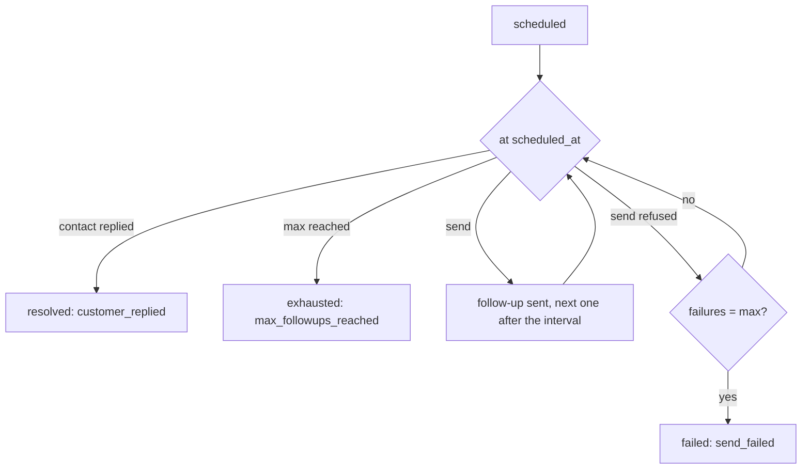

A follow-up reminds a contact who has not done what was expected (paid, sent a document, confirmed a visit): Shortext sends a reminder on the conversation, at regular intervals, until the contact replies or the maximum is reached. The agent sets follow-ups itself when a conversation calls for one; your systems can set them too.

Reading follow-ups and their types needs a key with **View messages**; creating and changing them needs **Send messages**.

## Follow-up types

A type sets the rhythm of its follow-ups. `/follow-up-types`:

| Field | Description |
| --- | --- |
| `name` | Required on creation, for example "Payment follow-up". |
| `description` | Tells the AI when to set this type. |
| `delay_minutes` | Before the first follow-up. |
| `interval_minutes` | Between two follow-ups. |
| `max_follow_ups` | How many follow-ups at most. |
| `active` | `false` stops new follow-ups of this type; the scheduled ones still go out. |
| `overrides` | Settings for one sender, over the type's own: `[{ "channel_id", "delay_minutes"?, "interval_minutes"?, "max_follow_ups"? }]`. When given on an update, it replaces all the overrides. |
| `color` | For the dashboard. |

```bash
curl -X POST https://shortext.ny-corp.io/api/v2.0/follow-up-types \
  -H "Authorization: Bearer $SHORTEXT_API_KEY" \
  -H "Accept: application/json" -H "Content-Type: application/json" \
  -d '{
    "name": "Payment follow-up",
    "description": "The customer received an invoice and has not paid yet.",
    "delay_minutes": 60,
    "interval_minutes": 1440,
    "max_follow_ups": 3,
    "overrides": [ { "channel_id": "532867649916076", "interval_minutes": 2880 } ]
  }'
```

Changes apply to the scheduled follow-ups from their next round. Deleting a type does not cancel its scheduled follow-ups: set `active` to `false` to stop new ones only.

## Set a follow-up

`POST /follow-ups` on a conversation:

```json
{
  "conversation_id": "c9Lw3nYb",
  "type_id": "FUI-XXXXX",
  "reason": "Pay invoice A-1042 (25,000 XAF) with the link sent on Monday."
}
```

| Field | Description |
| --- | --- |
| `conversation_id` | Required. The conversation to follow up (`GET /conversations`). |
| `type_id` | Required. The type (`GET /follow-up-types`). |
| `reason` | Required. What is expected from the contact: **the AI writes each follow-up from it**. |
| `message` | Optional. A fixed text sent instead of the AI-written one. |
| `scheduled_at` | Optional. The first follow-up; by default after the delay of the type. |
| `campaign_id` | Optional. The campaign the follow-up belongs to. |

If a follow-up of the same type is already scheduled on the conversation, that one is returned instead of a second one.

## When follow-ups are sent



- Each follow-up uses the interval and the maximum of the type, or of its override for the sender of the conversation.
- **The contact replies**: follow-ups stop (`resolved`, closed by `customer_replied`).
- **The maximum is reached** without a reply: `exhausted`.
- **A send is refused** by the channel: it is not counted as a follow-up and is retried at the next interval; after as many failures as the maximum, the follow-up is `failed` (`send_failed`). `failed` and `last_error` tell you why.

<Note>On WhatsApp, outside the 24-hour window, a free text would be refused: the follow-up is sent inside an approved **utility template** instead, so it still reaches the contact.</Note>

## Change or stop a follow-up

| Endpoint | Effect |
| --- | --- |
| `POST /follow-ups/{id}/reschedule` | Moves the next follow-up: `{ "scheduled_at": "..." }`. |
| `POST /follow-ups/{id}/resolve` | The goal is reached: no more follow-ups. Optional `note`. |
| `POST /follow-ups/{id}/cancel` | No more follow-ups. Optional `note`. |

`GET /follow-ups` lists follow-ups, the next one first, filterable by `status` (`scheduled`, `resolved`, `exhausted`, `cancelled`, `failed`), `conversation_id`, `type_id` and `campaign_id`. Each follow-up tells who set it (`set_by`: `ai`, `agent` or `api`), how many were `sent`, the next `scheduled_at`, and, once closed, `closed_at` and `closed_by` (`customer_replied`, `agent`, `ai`, `api`, `max_followups_reached`, `expired`, `cancelled`, `send_failed`).

## With campaigns

A campaign can name the follow-up types the agent follows after the send (`follow_up_intention_ids`), and you can attach a follow-up to a campaign with `campaign_id`. The [campaign report](/api-reference/guides/campaign-report) counts the recipients with a follow-up intention, and `GET /campaigns/{id}/recipients?filter=read_no_reply` lists the contacts worth following up.
