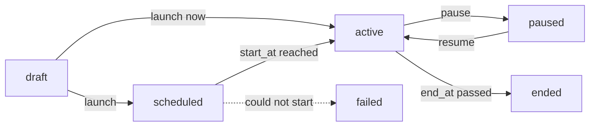

A campaign sends one message to many contacts at once, on WhatsApp (an approved template) and by email. It is also available in the dashboard under **Marketing > Campaigns**. The endpoints below need a key with **Send messages**; reading the report and the recipients needs **View messages** (see [Read a campaign report](/api-reference/guides/campaign-report)).

## The life of a campaign



A campaign is created as a **draft**. It ends when its `end_at` date has passed. A campaign that could not start is `failed`, with the reason in `failure_reason`; fix it and launch it again. You can edit a draft, a failed or a paused campaign; pause a scheduled or running campaign before editing it.

## 1. Create the campaign

`POST /campaigns`

```bash
curl -X POST https://shortext.ny-corp.io/api/v2.0/campaigns \
  -H "Authorization: Bearer $SHORTEXT_API_KEY" \
  -H "Accept: application/json" -H "Content-Type: application/json" \
  -d '{
    "name": "October promotion",
    "category": "marketing",
    "trigger": "scheduled",
    "channels": [
      { "channel_id": "532867649916076" },
      { "channel_id": "mbx_xxx" }
    ],
    "messages": {
      "whatsapp": {
        "template_id": "t4Hd6sFe",
        "variables": {
          "name": { "source": "field:firstname", "fallback": "dear customer" },
          "amount": { "source": "column:amount", "fallback": "10%" }
        },
        "buttons": { "0": "PROMO-OCT" }
      },
      "mail": {
        "subject": "Our October offer, @firstname",
        "html": "<p>Hello @{firstname|there},</p><p>Enjoy @{amount|10%} off this week.</p>"
      }
    },
    "audience": { "source": "segment", "segment_id": "SEG-XXXXX" },
    "end_at": "2026-11-01T23:59:00+01:00",
    "send_window": { "start": "08:00", "end": "20:00" }
  }'
```

| Field | Description |
| --- | --- |
| `name` | Required on creation. |
| `category` | Required on creation: `marketing`, `transactional` or `specialized`. Contacts who unsubscribed get no marketing campaign. |
| `trigger` | Required on creation. `scheduled`: sent once to an audience. `new_conversation`: an automatic campaign, sent on each new conversation while it is active. |
| `channels` | The senders, by their `channel_id` (`GET /channels`): WhatsApp numbers and mailboxes. |
| `messages` | One message per channel, see below. |
| `audience` | Who receives it (scheduled campaigns), see below. |
| `start_at` | When to start; empty to start at launch. |
| `end_at` | Required to launch. Replies count for the campaign until this date. |
| `send_window` | Optional: the hours of the day it may send, in your company's time zone, for example `{ "start": "08:00", "end": "20:00" }`. Messages due outside it wait for the next opening. |
| `follow_up_intention_ids` | Optional: the [follow-up types](/api-reference/guides/follow-ups) the agent follows after the send (a callback, a document...). |
| `objective` | Optional, for your team. |

Automatic campaigns (`new_conversation`) also take `once_per_contact` (a contact gets the message once), `send_delay_minutes` (wait after the conversation starts) and `min_inactive_minutes` (wait for the conversation to be quiet).

### Messages

**WhatsApp** sends an approved [template](/channels/whatsapp-templates), with a value for each of its variables:

| Field | Description |
| --- | --- |
| `template_id` | The template (`GET /templates`). |
| `variables` | One entry per variable: `{ "source": ..., "value"?: ..., "fallback"?: ... }`. |
| `buttons` | The value of each button that needs one, by index: `{ "0": "PROMO-OCT" }`. |
| `header_url` | The media of an image, video or document header. |

The `source` of a variable is:

- `field:firstname`, `field:lastname`, `field:name`, `field:email`, `field:phone`, `field:address` or `field:identifier`: a field of the contact;
- `column:<key>`: a column of the [imported file](#a-contact-file), mapped as `var:<key>`;
- `text`, with `value`: the same text for everyone.

`fallback` is used when the contact has no value, so no message goes out with an empty variable. An automatic campaign may send a plain `{ "text": "..." }` instead of a template.

**Email** takes a `subject` and an `html` body. Texts accept `@firstname`, `@<column>` and `@{key|fallback}`.

### Audience

| `audience` | Recipients |
| --- | --- |
| `{ "source": "segment", "segment_id": "SEG-XXXXX" }` | A segment (`GET /campaign-segments`). A `rules` segment is evaluated when the campaign starts; a `list` segment is a fixed list. |
| `{ "source": "file", "import_id": "IMP-XXXXX", "save_as_segment"?: "..." }` | A checked contact file, optionally saved as a segment. |
| `{ "source": "contacts", "contact_ids": ["...", "..."] }` | Contacts you pick. |

### A contact file

Upload a `.xlsx` or `.csv` file with a phone number column, then map and check it:

<Steps>
  <Step title="Upload">
    ```bash
    curl -X POST https://shortext.ny-corp.io/api/v2.0/campaign-imports \
      -H "Authorization: Bearer $SHORTEXT_API_KEY" -H "Accept: application/json" \
      -F "file=@customers.xlsx"
    ```
    The response gives the import id (`IMP-XXXXX`) and its `columns`, with their header, sample values and a guessed `target`. Numbers without a country code get your company's.
  </Step>
  <Step title="Map the columns">
    `PATCH /campaign-imports/{id}` with what each column holds, by index: `phone` (one column, required), `first_name`, `last_name`, `email`, `var:<key>` (a variable for the message) or `ignore`.
    ```json
    { "columns": ["phone", "first_name", "var:amount"], "has_header": true }
    ```
  </Step>
  <Step title="Check">
    `POST /campaign-imports/{id}/check` counts the valid numbers, the merged duplicates, the invalid numbers (with their row), the unsubscribed contacts and the new contacts. With `"marketing": true` (default), unsubscribed contacts are counted out. A large file is checked in the background: `GET /campaign-imports/{id}` until its `status` is `checked`.
  </Step>
</Steps>

## 2. Check and estimate

Before launching, `GET /campaigns/{id}/checks` lists what must be true:

```json
[
  { "key": "senders", "state": "ok", "label": "Senders", "detail": null },
  { "key": "template", "state": "ok", "label": "WhatsApp template approved", "detail": null },
  { "key": "variables", "state": "warn", "label": "Variables", "detail": "12 recipients have no first name: the fallback is used" },
  { "key": "credit", "state": "block", "label": "Credit", "detail": "The balance does not cover the estimated cost" }
]
```

Checks cover the `senders`, the `messages`, the `template`, the `audience`, the `variables`, the `dates` and the `credit`. A `block` check stops the launch; a `warn` check does not.

`GET /campaigns/{id}/estimate` gives the cost: the reachable recipients per channel times the price of one message, which depends on its category (the template's, on WhatsApp) and on the recipient's country.

```json
{
  "currency": "EUR",
  "total": 41.6,
  "channels": [
    { "channel": "whatsapp", "recipients": 520, "cost": 39.5 },
    { "channel": "mail", "recipients": 210, "cost": 2.1 }
  ],
  "plan_remaining": null,
  "balance": 590.88,
  "balance_after": 549.28
}
```

## 3. Launch

`POST /campaigns/{id}/launch` sends now, or at `start_at` when it is in the future:

```json
{ "start_at": "2026-10-27T09:00:00+01:00" }
```

It is refused with the blocking checks when one blocks. An automatic campaign becomes `active` and sends on each new conversation.

## 4. Pause, resume, duplicate

| Endpoint | Effect |
| --- | --- |
| `POST /campaigns/{id}/pause` | The messages not sent yet wait; a start not reached yet is cancelled. |
| `POST /campaigns/{id}/resume` | Sends the messages left waiting, within the send window. |
| `POST /campaigns/{id}/duplicate` | A draft copy with the same settings, channels and messages, without audience (a segment is kept), dates or statistics. |
| `DELETE /campaigns/{id}` | Only for a campaign that never sent anything (a draft, a failed one). Pause a running campaign instead. |

`GET /campaigns` lists your campaigns, most recent first, filterable by `status` and `name`.
