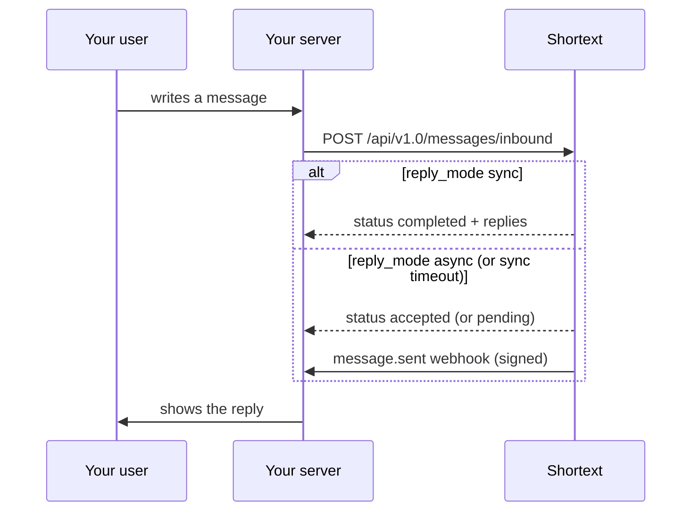

import Inbound from '/snippets/code/inbound.mdx';
import VerifySignature from '/snippets/code/verify-signature.mdx';

A [Shortext endpoint](/channels/shortext-endpoint) connects your own software to an agent. Your server posts each message written by one of your users; the agent answers; your server shows the reply.



## 1. Create the endpoint

From the dashboard or with `POST /api/v2.0/channels/shortext` (**Manage integrations**):

```json
{
  "name": "Mobile app",
  "agent_id": "AGI-XXXXX",
  "reply_mode": "async",
  "sync_timeout": 25,
  "webhook_url": "https://api.example.com/webhooks/shortext-replies"
}
```

| Field | Description |
| --- | --- |
| `name` | Required on creation. |
| `agent_id` | The agent that answers; `null` detaches the endpoint. |
| `enabled` | `true` by default. A disabled endpoint refuses inbound messages. |
| `reply_mode` | `async` (default): replies are pushed to `webhook_url`. `sync`: replies come back in the response of the inbound call. |
| `sync_timeout` | Seconds the sync mode waits for the replies, 1 to 25 (default 25). |
| `webhook_url` | Where replies are pushed (HTTPS). `null` removes it. |

The response is a channel with its id (`ste_...`) and `settings.inbound_url`. When you set a `webhook_url`, it also holds the **`webhook_secret`, shown once**. `POST /channels/shortext/{id}/rotate-secret` issues a new one (the old one stops working at once).

## 2. Send a user message

`POST https://shortext.ny-corp.io/api/v1.0/messages/inbound`, with your API key:

| Field | Description |
| --- | --- |
| `channel` | `shortext`. |
| `to` | The endpoint id, `ste_...`. |
| `contact` | Your user, see [Contact format](/api-reference/contact-format): `identifier` is your own user id, or a phone number or an email address with `identifier_type` (`external_id` by default, `phone`, `email`, `username`); the profile is optional. |
| `message.id` | **Your** id for this message, up to 100 characters. Used for idempotency. |
| `message.type` | `text`. |
| `message.content.text` | The text, up to 4,096 characters. |
| `message.metadata` | Optional object, kept with the message. |
| `reply_mode` | Optional: `sync` or `async`, overrides the endpoint setting for this message. |

<Inbound />

<Tip>If your users sign in with their phone number or email address, send it with `"identifier_type": "phone"` or `"email"`: the same person is then one contact across your app, WhatsApp and email. See [Contact format](/api-reference/contact-format#identifier-type-on-a-shortext-endpoint).</Tip>

<Note>This endpoint is served under `/api/v1.0` and works with the same API keys as v2.0. It does not check key permissions.</Note>

## 3. Read the outcome

The response `body` holds `status`, the stored `message` and, in sync mode, `replies`:

```json
{
  "success": true,
  "message": "Request success.",
  "code": 1000,
  "body": {
    "status": "completed",
    "message": { "id": "k5Rz8pQw", "direction": "inbound", "channel": "shortext", "channel_id": "ste_xxx", "contact": { "identifier": "user-42", "identifier_type": "external_id", "profile": {} }, "message": { "id": "msg_9f8e7d", "type": "text", "content": { "text": "Where is my order?" } }, "status": "received" },
    "replies": [
      { "id": "m2Tq7vXa", "direction": "outbound", "channel": "shortext", "channel_id": "ste_xxx", "contact": { "identifier": "user-42" }, "message": { "id": "shortext-generated-id", "type": "text", "content": { "text": "Could you give me your order reference?" } }, "status": "sent" }
    ]
  }
}
```

| `status` | Meaning | Replies |
| --- | --- | --- |
| `completed` | Sync: the agent answered in time. | In `replies`. |
| `pending` | Sync: the agent did not answer within `sync_timeout`. | Pushed to the webhook. |
| `accepted` | Async: the message is queued. | Pushed to the webhook. |
| `no_auto_reply` | Stored, but no automatic reply: the conversation is in handover, the endpoint has no agent or the agent is inactive, or your balance is insufficient. | A human may answer: pushed to the webhook. |
| `duplicate` | This `message.id` was already received. | The original message is returned, no new reply. |

## Idempotency

`message.id` is your own message id. If you send the same id again (a retry after a timeout, for example), Shortext does not store it twice nor answer twice: you get `duplicate` with the original message. Always retry with the **same** `message.id`.

## 4. Receive replies on your webhook

Replies (async mode, sync timeouts, answers written by your team in the Inbox) are posted to `webhook_url` as `message.sent` events, with the same body, headers and signature as every [Shortext webhook](/api-reference/webhooks):

```json
{
  "id": "evt_01JB8Z...",
  "type": "message.sent",
  "api_version": "v2.0",
  "created_at": "2026-10-24T09:12:51+00:00",
  "data": {
    "id": "m2Tq7vXa",
    "conversation_id": "c9Lw3nYb",
    "direction": "outbound",
    "channel": "shortext",
    "channel_id": "ste_xxx",
    "contact": { "identifier": "user-42", "identifier_type": "external_id", "profile": {} },
    "message": { "id": "shortext-generated-id", "type": "text", "content": { "text": "Could you give me your order reference?" } },
    "status": "sent",
    "created_at": "2026-10-24T09:12:51+00:00"
  }
}
```

Use `data.contact.identifier` (your user id) to route the reply to the right user. Verify the signature with the endpoint's `webhook_secret`:

<VerifySignature />

Deliveries are retried for about 21 hours on failure; deduplicate on the event `id`.

## Errors

| Situation | `code` |
| --- | --- |
| `channel` is not `shortext`, or `to` is not one of your endpoints | `1007` |
| The endpoint is disabled, or is not a server endpoint | `1005` |
| Invalid body | `1002` |
