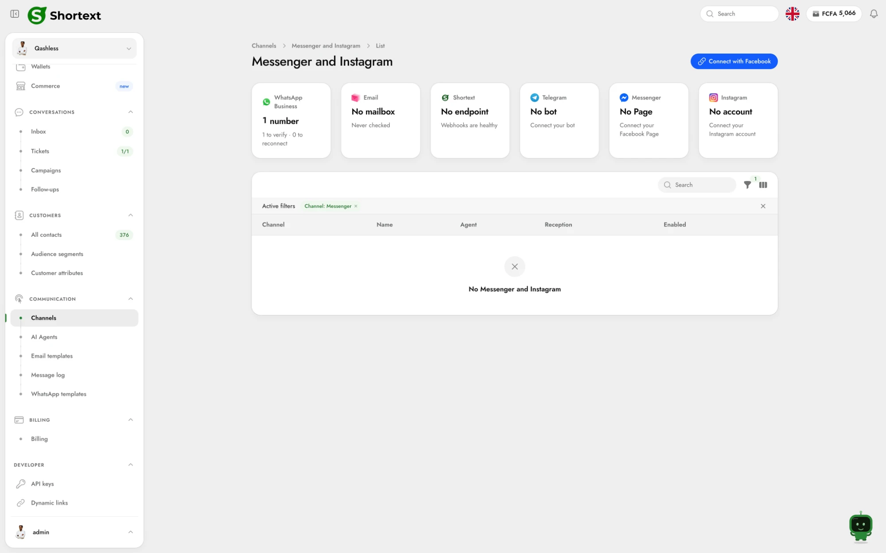

<Note>Messenger and Instagram are in early access while Meta reviews Shortext. To connect your Page now, write to [hello@ny-corp.io](mailto:hello@ny-corp.io).</Note>

Connect a Facebook Page and an agent answers the customers who write to it on **Messenger**. Connect the **Instagram** professional account linked to the Page and the agent also answers its direct messages. You connect them by logging in to Facebook from Shortext: no token to copy, no webhook to configure.

## Before you start

- A **Facebook Page** on which you can manage the messages: full control, or Facebook access with messages. Without this right, the Page is shown but cannot be ticked.
- For Instagram: an Instagram **professional** account (business or creator) **linked to that Page**, with **Allow access to messages** turned on in the Instagram app (**Settings > Messages > Connected tools**).

You connect both with your Facebook account, not with an Instagram login.

## Connect a Page or an Instagram account

<Steps>
  <Step title="Start the connection">
    Open **Communication > Channels > Messenger and Instagram** and click **Connect with Facebook**.

    <Frame>
      
    </Frame>
  </Step>
  <Step title="Log in to Facebook">
    In the Facebook window, log in and allow the Pages (and their Instagram accounts) Shortext may use.
  </Step>
  <Step title="Choose your channels">
    Back in Shortext, tick the Messenger Pages and the Instagram accounts to connect, and choose the agent that answers on them.

    {/* TODO screenshot: choice of the Pages and Instagram accounts. */}
  </Step>
</Steps>

Each Page connected on Messenger and each Instagram account is a channel of its own, with its own agent. A Page or an account can be connected to one Shortext account only.

If something goes wrong, the error says why, for example:

- the Page was not allowed in the Facebook window: start again and select it;
- you are not allowed to manage the messages of the Page;
- no Instagram professional account is linked to the Page;
- the Page or the account is already connected to another Shortext account;
- the Facebook login expired: start again.

### From your product

Your own clients can connect their Page and their Instagram account from your product with a [hosted session](/api-reference/hosted-sessions) of purpose `meta`, with `context.agent_id` to choose the agent. `result` lists the connected channels, in the same format as `GET /channels`.

## How customers reach you

Customers write first: they open your Page on Messenger, or send a direct message to your Instagram account. Share the link to write to you, given in the channel (`contact_url` in the API): `https://m.me/<page>` for Messenger, `https://ig.me/m/<account>` for Instagram, on your website, your social networks or a QR code.

To know where a contact comes from, add `?ref=` followed by a code, for example `https://m.me/acme?ref=website`. The code is attached to the first message sent from the link (in the message metadata); a person who opens the conversation without writing sends nothing.

## The 24-hour window

Meta only allows a business to answer within a window opened by the customer's last message:

| Since the customer's last message | What can be sent |
| --- | --- |
| Less than **24 hours** | Any message, from the agent, your team or the API. |
| From 24 hours to **7 days** | Only a person of your team, from the Inbox. |
| More than 7 days | Nothing, until the customer writes again. |

Outside the window, a message is refused with an explicit reason. This is a rule of Meta: there are no templates on Messenger and Instagram to write first, so:

- an automatic [follow-up](/api-reference/guides/follow-ups) is only sent within 24 hours of the customer's last message;
- [campaigns](/api-reference/guides/send-a-campaign) cannot be sent on Messenger and Instagram.

## Contacts

A contact is identified by the id Meta gives them for your Page or your account (`identifier_type` `messenger_psid` or `instagram_igsid`). The same person has a different id on each Page and each Instagram account. Meta gives no phone number.

## Messages

| Type | On Messenger and Instagram |
| --- | --- |
| Text | Sent and received. A long text is sent in several messages: **2,000** characters each on Messenger, **1,000** bytes on Instagram. |
| Images, videos, audio, documents | Sent and received. A caption is sent as a text after the file. |
| Stickers | Sent as an image; a sticker or a heart received arrives as a sticker. |
| Reply buttons and lists | Shown as quick replies under the message (up to 13, titles up to 20 characters). A tap comes back as a button reply. |
| Call to action, payment link | A link button under the text. |
| Carousel | Cards with an image, a text and buttons (up to 10). |
| Location, contact card | Sent as text (name, address and map link, or name and numbers). A location received arrives as a `location` message. |
| Templates, WhatsApp Flows | Not available: they are WhatsApp only. |

A shared post, a story mention or a link arrives as a text with its link, so the agent knows what it is about. Messages Shortext cannot read arrive as "Message not supported".

See [Message format](/api-reference/message-format) for the payloads.

## Billing

Each message sent on Messenger or Instagram is billed at your company's **service** rate, with no provider fee: Meta charges nothing on these channels. See [Balance and wallet movements](/api-reference/guides/balance).

## Disable or delete a channel

- **Disable** it to stop it: received messages are ignored and nothing is sent. Enable it again to resume.
- If Meta stops delivering the messages of a Page (`receiving` is `false`, `last_error` says why), **reconnect** it or **install the reception again** from the channel.
- **Delete** it when you no longer need it. It is final: the channel stops receiving on Shortext and its conversations leave the Inbox (they are kept for audits). Your Page and your Instagram account are not affected.

With the API: `PATCH /channels/messenger/{id}` or `/channels/instagram/{id}` changes `name`, `agent_id` and `enabled`; `DELETE` deletes the channel. List them with `GET /channels?type=messenger` or `?type=instagram`.
