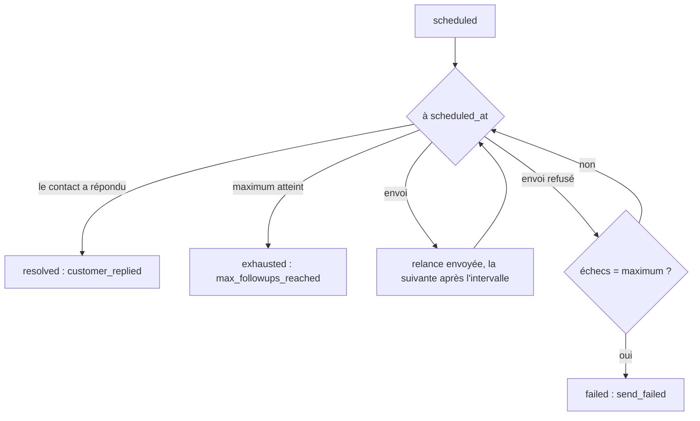

Une relance rappelle un contact qui n'a pas fait ce qui était attendu (payer, envoyer un document, confirmer une visite) : Shortext envoie un rappel sur la conversation, à intervalles réguliers, jusqu'à ce que le contact réponde ou que le maximum soit atteint. L'agent pose lui-même des relances quand une conversation le demande ; vos systèmes peuvent aussi en poser.

La lecture des relances et de leurs types demande une clé avec **Voir les messages** ; leur création et leur modification demandent **Envoyer des messages**.

## Types de relance

Un type fixe le rythme de ses relances. `/follow-up-types` :

| Champ | Description |
| --- | --- |
| `name` | Obligatoire à la création, par exemple « Relance de paiement ». |
| `description` | Indique à l'IA quand poser ce type. |
| `delay_minutes` | Avant la première relance. |
| `interval_minutes` | Entre deux relances. |
| `max_follow_ups` | Le nombre maximum de relances. |
| `active` | `false` arrête les nouvelles relances de ce type ; celles déjà programmées partent quand même. |
| `overrides` | Des réglages pour un émetteur, par-dessus ceux du type : `[{ "channel_id", "delay_minutes"?, "interval_minutes"?, "max_follow_ups"? }]`. Fourni lors d'une modification, il remplace tous les réglages par émetteur. |
| `color` | Pour le tableau de bord. |

```bash
curl -X POST https://shortext.ny-corp.io/api/v2.0/follow-up-types \
  -H "Authorization: Bearer $SHORTEXT_API_KEY" \
  -H "Accept: application/json" -H "Content-Type: application/json" \
  -d '{
    "name": "Relance de paiement",
    "description": "Le client a reçu une facture et ne l'\''a pas encore payée.",
    "delay_minutes": 60,
    "interval_minutes": 1440,
    "max_follow_ups": 3,
    "overrides": [ { "channel_id": "532867649916076", "interval_minutes": 2880 } ]
  }'
```

Les modifications s'appliquent aux relances programmées à partir de leur prochain tour. Supprimer un type n'annule pas ses relances programmées : passez `active` à `false` pour arrêter seulement les nouvelles.

## Poser une relance

`POST /follow-ups` sur une conversation :

```json
{
  "conversation_id": "c9Lw3nYb",
  "type_id": "FUI-XXXXX",
  "reason": "Payer la facture A-1042 (25 000 XAF) avec le lien envoyé lundi."
}
```

| Champ | Description |
| --- | --- |
| `conversation_id` | Obligatoire. La conversation à relancer (`GET /conversations`). |
| `type_id` | Obligatoire. Le type (`GET /follow-up-types`). |
| `reason` | Obligatoire. Ce qui est attendu du contact : **l'IA rédige chaque relance à partir de ce texte**. |
| `message` | Facultatif. Un texte fixe envoyé à la place de celui rédigé par l'IA. |
| `scheduled_at` | Facultatif. La première relance ; par défaut, après le délai du type. |
| `campaign_id` | Facultatif. La campagne à laquelle la relance appartient. |

Si une relance du même type est déjà programmée sur la conversation, c'est elle qui est renvoyée, au lieu d'en créer une seconde.

## Quand les relances partent



- Chaque relance utilise l'intervalle et le maximum du type, ou de son réglage pour l'émetteur de la conversation.
- **Le contact répond** : les relances s'arrêtent (`resolved`, clôturée par `customer_replied`).
- **Le maximum est atteint** sans réponse : `exhausted`.
- **Un envoi est refusé** par le canal : il n'est pas compté comme relance et il est retenté à l'intervalle suivant ; après autant d'échecs que le maximum, la relance passe en `failed` (`send_failed`). `failed` et `last_error` en donnent la raison.

<Note>Sur WhatsApp, hors de la fenêtre de 24 heures, un texte libre serait refusé : la relance est alors envoyée dans un **modèle utilitaire** approuvé, pour qu'elle atteigne quand même le contact.</Note>

## Modifier ou arrêter une relance

| Endpoint | Effet |
| --- | --- |
| `POST /follow-ups/{id}/reschedule` | Déplace la prochaine relance : `{ "scheduled_at": "..." }`. |
| `POST /follow-ups/{id}/resolve` | L'objectif est atteint : plus de relance. `note` facultative. |
| `POST /follow-ups/{id}/cancel` | Plus de relance. `note` facultative. |

`GET /follow-ups` liste les relances, la prochaine d'abord, filtrables par `status` (`scheduled`, `resolved`, `exhausted`, `cancelled`, `failed`), `conversation_id`, `type_id` et `campaign_id`. Chaque relance indique qui l'a posée (`set_by` : `ai`, `agent` ou `api`), combien ont été envoyées (`sent`), la prochaine `scheduled_at` et, une fois clôturée, `closed_at` et `closed_by` (`customer_replied`, `agent`, `ai`, `api`, `max_followups_reached`, `expired`, `cancelled`, `send_failed`).

## Avec les campagnes

Une campagne peut indiquer les types de relance que l'agent suit après l'envoi (`follow_up_intention_ids`), et vous pouvez rattacher une relance à une campagne avec `campaign_id`. Le [rapport de campagne](/fr/api-reference/guides/campaign-report) compte les destinataires avec une intention de relance, et `GET /campaigns/{id}/recipients?filter=read_no_reply` liste les contacts à relancer.
