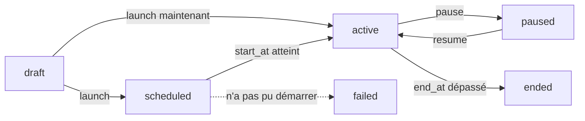

Une campagne envoie un même message à de nombreux contacts, sur WhatsApp (un modèle approuvé) et par e-mail. Elle est aussi disponible dans le tableau de bord, sous **Marketing > Campagnes**. Les endpoints ci-dessous demandent une clé avec **Envoyer des messages** ; la lecture du rapport et des destinataires demande **Voir les messages** (voir [Lire le rapport d'une campagne](/fr/api-reference/guides/campaign-report)).

## La vie d'une campagne



Une campagne est créée en **brouillon** (`draft`). Elle se termine (`ended`) une fois sa date `end_at` dépassée. Une campagne qui n'a pas pu démarrer est `failed`, avec la raison dans `failure_reason` ; corrigez-la et relancez-la. Vous pouvez modifier une campagne en brouillon, échouée ou en pause ; mettez en pause une campagne programmée ou en cours avant de la modifier.

## 1. Créer la campagne

`POST /campaigns`

```bash
curl -X POST https://shortext.ny-corp.io/api/v2.0/campaigns \
  -H "Authorization: Bearer $SHORTEXT_API_KEY" \
  -H "Accept: application/json" -H "Content-Type: application/json" \
  -d '{
    "name": "Promotion d'\''octobre",
    "category": "marketing",
    "trigger": "scheduled",
    "channels": [
      { "channel_id": "532867649916076" },
      { "channel_id": "mbx_xxx" }
    ],
    "messages": {
      "whatsapp": {
        "template_id": "t4Hd6sFe",
        "variables": {
          "name": { "source": "field:firstname", "fallback": "cher client" },
          "amount": { "source": "column:amount", "fallback": "10 %" }
        },
        "buttons": { "0": "PROMO-OCT" }
      },
      "mail": {
        "subject": "Notre offre d'\''octobre, @firstname",
        "html": "<p>Bonjour @{firstname|à vous},</p><p>Profitez de @{amount|10 %} de remise cette semaine.</p>"
      }
    },
    "audience": { "source": "segment", "segment_id": "SEG-XXXXX" },
    "end_at": "2026-11-01T23:59:00+01:00",
    "send_window": { "start": "08:00", "end": "20:00" }
  }'
```

| Champ | Description |
| --- | --- |
| `name` | Obligatoire à la création. |
| `category` | Obligatoire à la création : `marketing`, `transactional` ou `specialized`. Les contacts désinscrits ne reçoivent aucune campagne marketing. |
| `trigger` | Obligatoire à la création. `scheduled` : envoyée une fois à une audience. `new_conversation` : une campagne automatique, envoyée à chaque nouvelle conversation tant qu'elle est active. |
| `channels` | Les émetteurs, par leur `channel_id` (`GET /channels`) : numéros WhatsApp et boîtes mail. |
| `messages` | Un message par canal, voir ci-dessous. |
| `audience` | Les destinataires (campagnes programmées), voir ci-dessous. |
| `start_at` | Le démarrage ; vide pour démarrer au lancement. |
| `end_at` | Obligatoire pour lancer. Les réponses comptent pour la campagne jusqu'à cette date. |
| `send_window` | Facultatif : les heures de la journée où elle peut envoyer, dans le fuseau horaire de votre entreprise, par exemple `{ "start": "08:00", "end": "20:00" }`. Les messages prévus en dehors attendent la prochaine ouverture. |
| `follow_up_intention_ids` | Facultatif : les [types de relance](/fr/api-reference/guides/follow-ups) que l'agent suit après l'envoi (un rappel, un document...). |
| `objective` | Facultatif, pour votre équipe. |

Les campagnes automatiques (`new_conversation`) acceptent aussi `once_per_contact` (un contact ne reçoit le message qu'une fois), `send_delay_minutes` (attente après le début de la conversation) et `min_inactive_minutes` (attente que la conversation soit calme).

### Messages

**WhatsApp** envoie un [modèle](/fr/channels/whatsapp-templates) approuvé, avec une valeur pour chacune de ses variables :

| Champ | Description |
| --- | --- |
| `template_id` | Le modèle (`GET /templates`). |
| `variables` | Une entrée par variable : `{ "source": ..., "value"?: ..., "fallback"?: ... }`. |
| `buttons` | La valeur de chaque bouton qui en demande une, par index : `{ "0": "PROMO-OCT" }`. |
| `header_url` | Le média d'un en-tête image, vidéo ou document. |

La `source` d'une variable est :

- `field:firstname`, `field:lastname`, `field:name`, `field:email`, `field:phone`, `field:address` ou `field:identifier` : un champ du contact ;
- `column:<clé>` : une colonne du [fichier importé](#un-fichier-de-contacts), associée comme `var:<clé>` ;
- `text`, avec `value` : le même texte pour tous.

`fallback` est utilisé quand le contact n'a pas de valeur, pour qu'aucun message ne parte avec une variable vide. Une campagne automatique peut envoyer un simple `{ "text": "..." }` au lieu d'un modèle.

**L'e-mail** prend un `subject` et un corps `html`. Les textes acceptent `@firstname`, `@<colonne>` et `@{clé|valeur par défaut}`.

### Audience

| `audience` | Destinataires |
| --- | --- |
| `{ "source": "segment", "segment_id": "SEG-XXXXX" }` | Un segment (`GET /campaign-segments`). Un segment `rules` est évalué au démarrage de la campagne ; un segment `list` est une liste fixe. |
| `{ "source": "file", "import_id": "IMP-XXXXX", "save_as_segment"?: "..." }` | Un fichier de contacts contrôlé, éventuellement enregistré comme segment. |
| `{ "source": "contacts", "contact_ids": ["...", "..."] }` | Des contacts que vous choisissez. |

### Un fichier de contacts

Envoyez un fichier `.xlsx` ou `.csv` avec une colonne de numéros de téléphone, puis associez ses colonnes et contrôlez-le :

<Steps>
  <Step title="Envoyer">
    ```bash
    curl -X POST https://shortext.ny-corp.io/api/v2.0/campaign-imports \
      -H "Authorization: Bearer $SHORTEXT_API_KEY" -H "Accept: application/json" \
      -F "file=@clients.xlsx"
    ```
    La réponse donne l'identifiant de l'import (`IMP-XXXXX`) et ses `columns`, avec leur en-tête, des valeurs d'exemple et une `target` devinée. Les numéros sans indicatif reçoivent celui de votre entreprise.
  </Step>
  <Step title="Associer les colonnes">
    `PATCH /campaign-imports/{id}` avec le contenu de chaque colonne, par index : `phone` (une colonne, obligatoire), `first_name`, `last_name`, `email`, `var:<clé>` (une variable pour le message) ou `ignore`.
    ```json
    { "columns": ["phone", "first_name", "var:amount"], "has_header": true }
    ```
  </Step>
  <Step title="Contrôler">
    `POST /campaign-imports/{id}/check` compte les numéros valides, les doublons fusionnés, les numéros invalides (avec leur ligne), les contacts désinscrits et les nouveaux contacts. Avec `"marketing": true` (par défaut), les contacts désinscrits sont exclus du compte. Un gros fichier est contrôlé en arrière-plan : appelez `GET /campaign-imports/{id}` jusqu'à ce que son `status` soit `checked`.
  </Step>
</Steps>

## 2. Vérifier et estimer

Avant le lancement, `GET /campaigns/{id}/checks` liste ce qui doit être vrai :

```json
[
  { "key": "senders", "state": "ok", "label": "Senders", "detail": null },
  { "key": "template", "state": "ok", "label": "WhatsApp template approved", "detail": null },
  { "key": "variables", "state": "warn", "label": "Variables", "detail": "12 recipients have no first name: the fallback is used" },
  { "key": "credit", "state": "block", "label": "Credit", "detail": "The balance does not cover the estimated cost" }
]
```

Les contrôles portent sur les émetteurs (`senders`), les messages (`messages`), le modèle (`template`), l'audience (`audience`), les variables (`variables`), les dates (`dates`) et le crédit (`credit`). Un contrôle `block` empêche le lancement ; un contrôle `warn`, non.

`GET /campaigns/{id}/estimate` donne le coût : les destinataires joignables par canal multipliés par le prix d'un message, qui dépend de sa catégorie (celle du modèle, sur WhatsApp) et du pays du destinataire.

```json
{
  "currency": "EUR",
  "total": 41.6,
  "channels": [
    { "channel": "whatsapp", "recipients": 520, "cost": 39.5 },
    { "channel": "mail", "recipients": 210, "cost": 2.1 }
  ],
  "plan_remaining": null,
  "balance": 590.88,
  "balance_after": 549.28
}
```

## 3. Lancer

`POST /campaigns/{id}/launch` envoie maintenant, ou à `start_at` si cette date est future :

```json
{ "start_at": "2026-10-27T09:00:00+01:00" }
```

Le lancement est refusé, avec les contrôles bloquants, si l'un d'eux bloque. Une campagne automatique devient `active` et envoie à chaque nouvelle conversation.

## 4. Pause, reprise, duplication

| Endpoint | Effet |
| --- | --- |
| `POST /campaigns/{id}/pause` | Les messages pas encore envoyés attendent ; un démarrage pas encore atteint est annulé. |
| `POST /campaigns/{id}/resume` | Envoie les messages en attente, dans la plage d'envoi. |
| `POST /campaigns/{id}/duplicate` | Une copie en brouillon avec les mêmes réglages, canaux et messages, sans audience (un segment est conservé), dates ni statistiques. |
| `DELETE /campaigns/{id}` | Uniquement pour une campagne qui n'a jamais rien envoyé (un brouillon, une campagne échouée). Mettez plutôt en pause une campagne en cours. |

`GET /campaigns` liste vos campagnes, les plus récentes d'abord, filtrables par `status` et `name`.
