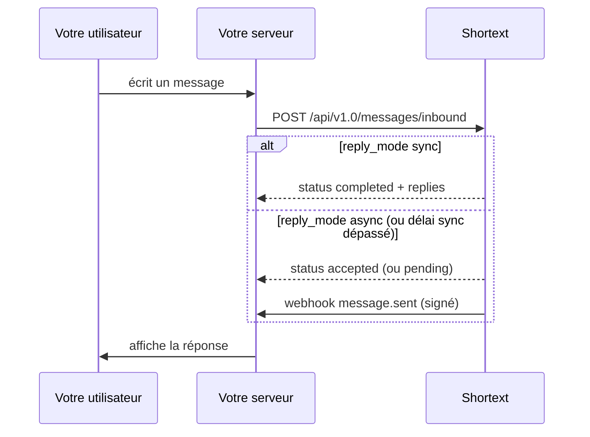

import Inbound from '/snippets/code/inbound.mdx';
import VerifySignature from '/snippets/code/verify-signature.mdx';

Un [endpoint Shortext](/fr/channels/shortext-endpoint) relie votre propre logiciel à un agent. Votre serveur envoie chaque message écrit par l'un de vos utilisateurs ; l'agent répond ; votre serveur affiche la réponse.



## 1. Créer l'endpoint

Depuis le tableau de bord ou avec `POST /api/v2.0/channels/shortext` (**Gérer les intégrations**) :

```json
{
  "name": "Application mobile",
  "agent_id": "AGI-XXXXX",
  "reply_mode": "async",
  "sync_timeout": 25,
  "webhook_url": "https://api.example.com/webhooks/shortext-replies"
}
```

| Champ | Description |
| --- | --- |
| `name` | Obligatoire à la création. |
| `agent_id` | L'agent qui répond ; `null` détache l'endpoint. |
| `enabled` | `true` par défaut. Un endpoint désactivé refuse les messages entrants. |
| `reply_mode` | `async` (par défaut) : les réponses sont envoyées à `webhook_url`. `sync` : les réponses reviennent dans la réponse de l'appel entrant. |
| `sync_timeout` | Secondes pendant lesquelles le mode sync attend les réponses, de 1 à 25 (25 par défaut). |
| `webhook_url` | Là où les réponses sont envoyées (HTTPS). `null` la supprime. |

La réponse est un canal avec son identifiant (`ste_...`) et `settings.inbound_url`. Quand vous définissez une `webhook_url`, elle contient aussi le **`webhook_secret`, affiché une seule fois**. `POST /channels/shortext/{id}/rotate-secret` en génère un nouveau (l'ancien cesse aussitôt de fonctionner).

## 2. Envoyer un message utilisateur

`POST https://shortext.ny-corp.io/api/v1.0/messages/inbound`, avec votre clé API :

| Champ | Description |
| --- | --- |
| `channel` | `shortext`. |
| `to` | L'identifiant de l'endpoint, `ste_...`. |
| `contact` | Votre utilisateur, voir [Format des contacts](/fr/api-reference/contact-format) : `identifier` est votre propre identifiant utilisateur, ou un numéro de téléphone ou une adresse e-mail avec `identifier_type` (`external_id` par défaut, `phone`, `email`, `username`) ; le profil est facultatif. |
| `message.id` | **Votre** identifiant pour ce message, jusqu'à 100 caractères. Sert à l'idempotence. |
| `message.type` | `text`. |
| `message.content.text` | Le texte, jusqu'à 4 096 caractères. |
| `message.metadata` | Objet facultatif, conservé avec le message. |
| `reply_mode` | Facultatif : `sync` ou `async`, remplace le réglage de l'endpoint pour ce message. |

<Inbound />

<Tip>Si vos utilisateurs se connectent avec leur numéro de téléphone ou leur adresse e-mail, envoyez-le avec `"identifier_type": "phone"` ou `"email"` : une même personne forme alors un seul contact entre votre application, WhatsApp et l'e-mail. Voir [Format des contacts](/fr/api-reference/contact-format#type-d’identifiant-sur-un-endpoint-shortext).</Tip>

<Note>Cet endpoint est servi sous `/api/v1.0` et fonctionne avec les mêmes clés API que la v2.0. Il ne vérifie pas les permissions des clés.</Note>

## 3. Lire le résultat

Le `body` de la réponse contient `status`, le `message` enregistré et, en mode sync, `replies` :

```json
{
  "success": true,
  "message": "Request success.",
  "code": 1000,
  "body": {
    "status": "completed",
    "message": { "id": "k5Rz8pQw", "direction": "inbound", "channel": "shortext", "channel_id": "ste_xxx", "contact": { "identifier": "user-42", "identifier_type": "external_id", "profile": {} }, "message": { "id": "msg_9f8e7d", "type": "text", "content": { "text": "Where is my order?" } }, "status": "received" },
    "replies": [
      { "id": "m2Tq7vXa", "direction": "outbound", "channel": "shortext", "channel_id": "ste_xxx", "contact": { "identifier": "user-42" }, "message": { "id": "shortext-generated-id", "type": "text", "content": { "text": "Could you give me your order reference?" } }, "status": "sent" }
    ]
  }
}
```

| `status` | Signification | Réponses |
| --- | --- | --- |
| `completed` | Sync : l'agent a répondu à temps. | Dans `replies`. |
| `pending` | Sync : l'agent n'a pas répondu dans le délai `sync_timeout`. | Envoyées au webhook. |
| `accepted` | Async : le message est en file. | Envoyées au webhook. |
| `no_auto_reply` | Enregistré, mais sans réponse automatique : la conversation est prise en main, l'endpoint n'a pas d'agent ou l'agent est inactif, ou votre solde est insuffisant. | Une personne peut répondre : envoyée au webhook. |
| `duplicate` | Ce `message.id` a déjà été reçu. | Le message d'origine est renvoyé, sans nouvelle réponse. |

## Idempotence

`message.id` est votre propre identifiant de message. Si vous renvoyez le même identifiant (une relance après un délai dépassé, par exemple), Shortext ne l'enregistre pas deux fois et ne répond pas deux fois : vous obtenez `duplicate` avec le message d'origine. Relancez toujours avec le **même** `message.id`.

## 4. Recevoir les réponses sur votre webhook

Les réponses (mode async, délais sync dépassés, réponses rédigées par votre équipe dans la boîte de réception) sont envoyées à `webhook_url` sous forme d'événements `message.sent`, avec le même corps, les mêmes en-têtes et la même signature que tous les [webhooks Shortext](/fr/api-reference/webhooks) :

```json
{
  "id": "evt_01JB8Z...",
  "type": "message.sent",
  "api_version": "v2.0",
  "created_at": "2026-10-24T09:12:51+00:00",
  "data": {
    "id": "m2Tq7vXa",
    "conversation_id": "c9Lw3nYb",
    "direction": "outbound",
    "channel": "shortext",
    "channel_id": "ste_xxx",
    "contact": { "identifier": "user-42", "identifier_type": "external_id", "profile": {} },
    "message": { "id": "shortext-generated-id", "type": "text", "content": { "text": "Could you give me your order reference?" } },
    "status": "sent",
    "created_at": "2026-10-24T09:12:51+00:00"
  }
}
```

Utilisez `data.contact.identifier` (votre identifiant utilisateur) pour acheminer la réponse vers le bon utilisateur. Vérifiez la signature avec le `webhook_secret` de l'endpoint :

<VerifySignature />

En cas d'échec, les livraisons sont relancées pendant environ 21 heures ; dédoublonnez sur l'`id` de l'événement.

## Erreurs

| Situation | `code` |
| --- | --- |
| `channel` n'est pas `shortext`, ou `to` n'est pas l'un de vos endpoints | `1007` |
| L'endpoint est désactivé, ou n'est pas un endpoint serveur | `1005` |
| Corps invalide | `1002` |
