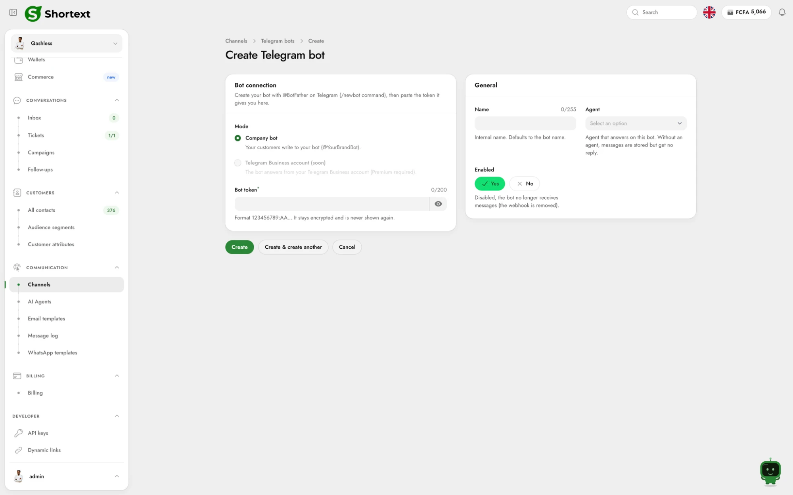

Connectez un bot Telegram à Shortext et un agent répond aux clients qui lui écrivent. Vous créez le bot vous-même avec ＠BotFather, le bot officiel de Telegram, puis vous donnez son token à Shortext : aucune page de connexion, le token suffit.

## Connecter un bot

<Steps>
  <Step title="Créer le bot avec ＠BotFather">
    Dans Telegram, ouvrez [＠BotFather](https://t.me/BotFather), envoyez `/newbot` et choisissez un nom et un nom d'utilisateur pour votre bot (il doit finir par `bot`, par exemple `AcmeSupportBot`).

    ＠BotFather répond avec le **token** du bot, de la forme `123456789:AA...`. Copiez-le.

    <Warning>Le token donne le contrôle total du bot. Ne le partagez pas en dehors de Shortext.</Warning>
  </Step>
  <Step title="Ajouter le bot dans Shortext">
    Ouvrez **Communication > Canaux > Telegram**, créez un bot et collez le token.

    <Frame>
      
    </Frame>
  </Step>
  <Step title="Choisir l'agent">
    Choisissez l'agent qui répond sur ce bot. Vous pouvez le changer à tout moment.
  </Step>
  <Step title="Enregistrer">
    Shortext vérifie le token auprès de Telegram et le bot commence aussitôt à recevoir les messages.
  </Step>
</Steps>

Le token est chiffré et n'est plus jamais affiché, ni dans le tableau de bord ni dans l'API.

Un bot ne peut être connecté qu'une fois. Si le token est mal formé, refusé par Telegram ou appartient à un bot déjà connecté, le bot n'est pas enregistré et l'erreur dit pourquoi.

### Avec l'API

`POST /channels/telegram` connecte un bot (permission **Manage integrations**) :

```json
{
  "bot_token": "123456789:AAH...",
  "name": "Support Acme",
  "agent_id": "AGI-XXXXX",
  "enabled": true
}
```

| Champ | Description |
| --- | --- |
| `bot_token` | Obligatoire. Le token donné par ＠BotFather. Jamais renvoyé. |
| `name` | Facultatif, un nom interne. Par défaut : le nom du bot. |
| `agent_id` | Facultatif, l'agent qui répond sur le bot ; `null` le laisse détaché. |
| `enabled` | Facultatif, `true` par défaut. |

La réponse est le canal, tel que renvoyé par `GET /channels`, avec l'identifiant `tga_...` et ces `settings` :

| Réglage | Description |
| --- | --- |
| `username` | Le nom d'utilisateur du bot, sans `@`. |
| `bot_url` | Le lien à partager avec vos clients, par exemple `https://t.me/AcmeSupportBot`. |
| `receiving` | `true` quand le bot est activé et que Telegram lui livre ses messages. |
| `last_error` | Le dernier refus de Telegram, `null` quand tout va bien. |

Un token faux, refusé ou déjà connecté est une erreur de validation (`1002`) sur `bot_token`.

`PATCH /channels/telegram/{id}` modifie les champs envoyés, et `DELETE /channels/telegram/{id}` supprime le bot. Listez vos bots avec `GET /channels?type=telegram`, et rattachez ou détachez l'agent avec `PUT` et `DELETE /channels/telegram/{id}/agent`, comme pour les autres canaux.

## Comment les clients vous joignent

Sur Telegram, c'est le client qui écrit en premier : il ouvre votre bot et appuie sur **Démarrer**. Un bot ne peut pas écrire à quelqu'un qui ne l'a jamais démarré.

Partagez le lien de votre bot, `https://t.me/<username>`, sur votre site, dans vos e-mails ou en QR code. Pour savoir d'où vient un client, ajoutez `?start=` suivi d'un code, par exemple `https://t.me/AcmeSupportBot?start=site`. Le code fait 64 caractères au plus : lettres, chiffres, `_` et `-`.

Une fois que le client a démarré le bot, vous pouvez lui écrire quand vous voulez : pas de fenêtre de 24 heures ni de modèle sur Telegram.

## Contacts

Un contact Telegram est identifié par son **identifiant d'utilisateur Telegram**. Telegram ne donne ni son numéro ni son pays, sauf si le client choisit de partager son numéro.

Un client qui bloque le bot est désabonné. S'il démarre à nouveau le bot, il est réabonné.

Seules les conversations privées avec le bot sont prises en charge, pas les groupes.

## Messages

| Type | Sur Telegram |
| --- | --- |
| Texte | Le formatage est rendu : `*gras*`, `_italique_`, `~barré~` et `` `code` ``. |
| Images, vidéos, documents | Envoyés et reçus. |
| Messages vocaux | Envoyés et reçus ; l'agent peut répondre par un message vocal. |
| Stickers | Envoyés et reçus. |
| Positions | Envoyées et reçues ; avec un nom et une adresse, un lieu nommé. |
| Fiches contact | Envoyées : un numéro affiché, les autres dans la fiche. Un numéro partagé par le client est reçu. |
| Boutons de réponse et listes | Affichés en boutons sous le message. Un appui revient comme une réponse de bouton. |
| Call-to-action, lien de paiement | Affichés en bouton lien sous le message. |

Voir [Format des messages](/fr/api-reference/message-format#rendu-par-canal) pour le contenu de chaque message.

Limites :

- **4 096 caractères** par message, **1 024** pour la légende d'un média ;
- fichiers reçus des clients jusqu'à **20 Mo** ;
- environ **un message par seconde** dans chaque conversation.

Telegram n'envoie aucun accusé de livraison ni de lecture : un message accepté par Telegram est marqué `delivered`.

## Facturation

Chaque message envoyé sur Telegram est facturé au tarif **service** de votre entreprise (plus la réponse IA au-delà de votre forfait), sans frais fournisseur : Telegram ne facture rien. Voir [Solde et mouvements du portefeuille](/fr/api-reference/guides/balance).

## Désactiver ou supprimer un bot

- **Désactivez** le bot pour arrêter la réception des messages ; réactivez-le pour reprendre. Si vous régénérez le token dans ＠BotFather, mettez-le à jour dans Shortext (`PATCH` avec le nouveau `bot_token`) : seul un token du même bot est accepté.
- **Supprimez-le** quand vous n'en avez plus besoin. C'est définitif : le bot ne reçoit plus rien et ses conversations quittent l'Inbox (elles sont gardées pour les audits). Le bot lui-même reste à vous dans ＠BotFather.
