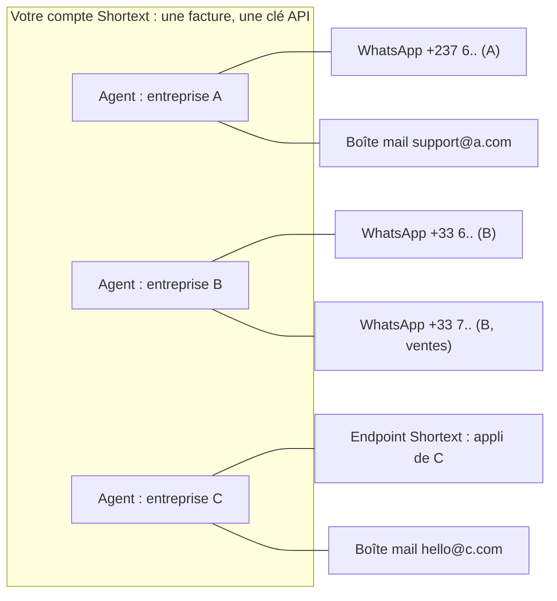

Vous intégrez Shortext pour **plusieurs entreprises** : vos clients, vos franchises, les marques d'un groupe. Inutile d'ouvrir un compte Shortext par entreprise. Créez **un agent par entreprise** dans votre propre compte, et rattachez à chaque agent les canaux de cette entreprise.

## Le modèle

- **Une entreprise = un agent.** L'agent porte l'identité de l'entreprise : son nom, ses instructions (ton, règles, ce qu'il peut dire), sa base de connaissances, ses outils, ses tickets.
- **Un agent, plusieurs canaux.** Un agent peut répondre sur autant de canaux que l'entreprise en possède : plusieurs numéros WhatsApp, des boîtes mail, des endpoints Shortext pour ses applications. Toutes les conversations de ces canaux reçoivent la réponse de l'agent de l'entreprise.
- **Un compte, une facture.** Toute la consommation est débitée du portefeuille unique de votre compte. Vous gérez un abonnement, un solde et une série de factures, quel que soit le nombre d'entreprises.

## Ce que chaque agent garde séparé

Tout ce qui définit la façon dont une entreprise est servie appartient à son agent :

| Par agent | Où |
| --- | --- |
| Instructions et réglages de l'IA | [Créer un agent](/fr/agents/creating-an-agent) |
| Base de connaissances et connaissances de contact | [Connaissances de l'agent](/fr/api-reference/guides/agent-knowledge) |
| Outils (appels aux API de l'entreprise) | [Outils](/fr/agents/tools-configuration) |
| Canaux (numéros WhatsApp, boîtes mail, endpoints Shortext) | [Canaux](/fr/channels/overview) |
| Statuts de tickets et politiques de SLA | [Gérer les tickets](/fr/api-reference/guides/manage-tickets) |
| Applications ouvertes par les liens dynamiques | [Liens dynamiques](/fr/api-reference/guides/dynamic-links) |

Et l'API permet de travailler entreprise par entreprise : filtrer les conversations avec `agent_id`, filtrer les tickets avec `agent_id`, et limiter un endpoint webhook à un agent avec `filters.app`.

## Mise en place

<Steps>
  <Step title="Créez un agent par entreprise">
    Dans **Communication > Agents IA**, ou avec `POST /agents`. Donnez-lui le nom de l'entreprise, pour que votre équipe le reconnaisse dans la boîte de réception. Rédigez des instructions qui parlent au nom de cette entreprise.
  </Step>
  <Step title="Rattachez les canaux de l'entreprise à son agent">
    Connectez chaque numéro WhatsApp, boîte mail ou endpoint Shortext et choisissez l'agent de l'entreprise. Vous pouvez aussi laisser l'entreprise connecter elle-même son numéro WhatsApp ou sa boîte mail depuis votre produit grâce à une [session hébergée](/fr/api-reference/guides/connect-whatsapp), en passant `context.agent_id` : le nouveau canal est directement rattaché au bon agent.

    <Warning>Passez toujours `context.agent_id` quand vous servez plusieurs entreprises : sans lui, le nouveau canal est rattaché au premier agent de votre compte.</Warning>
  </Step>
  <Step title="Donnez à chaque agent ses connaissances et ses outils">
    Chargez les documents de l'entreprise et configurez les outils qui appellent ses systèmes.
  </Step>
  <Step title="Acheminez les événements par entreprise">
    Créez un endpoint webhook par entreprise avec `"filters": { "app": "AGI-XXXXX" }`, ou un seul endpoint qui aiguille selon l'agent de chaque événement (`channel_id`, conversation).
  </Step>
</Steps>

## Points à anticiper

- **Limite d'agents.** Votre forfait fixe le nombre d'agents de votre compte, donc le nombre d'entreprises que vous pouvez servir. Voir [Limite d'agents de votre forfait](/fr/agents/creating-an-agent#limite-d’agents-de-votre-forfait).
- **Accès de l'équipe.** Les membres de votre compte voient les conversations de tous les agents, dans la limite de leur rôle. Shortext ne limite pas un membre à un seul agent : donnez l'accès au tableau de bord à votre propre équipe, et si une entreprise doit voir ses conversations, construisez cette vue dans votre produit avec l'API, filtrée par `agent_id`.
- **Refacturer vos clients.** Le portefeuille est commun : les mouvements ne sont pas ventilés par agent. Pour refacturer chaque entreprise, mesurez son activité via l'API, par exemple ses conversations avec `GET /conversations?agent_id=...`.
- **Une clé API pour tous.** Les clés API appartiennent à votre compte et donnent accès à tous les agents. Gardez-les sur vos serveurs ; n'en confiez jamais une à une entreprise cliente.

<Tip>Une entreprise qui a besoin de sa propre facturation, de sa propre équipe avec des accès séparés ou de ses propres clés API doit plutôt avoir son propre compte Shortext.</Tip>
