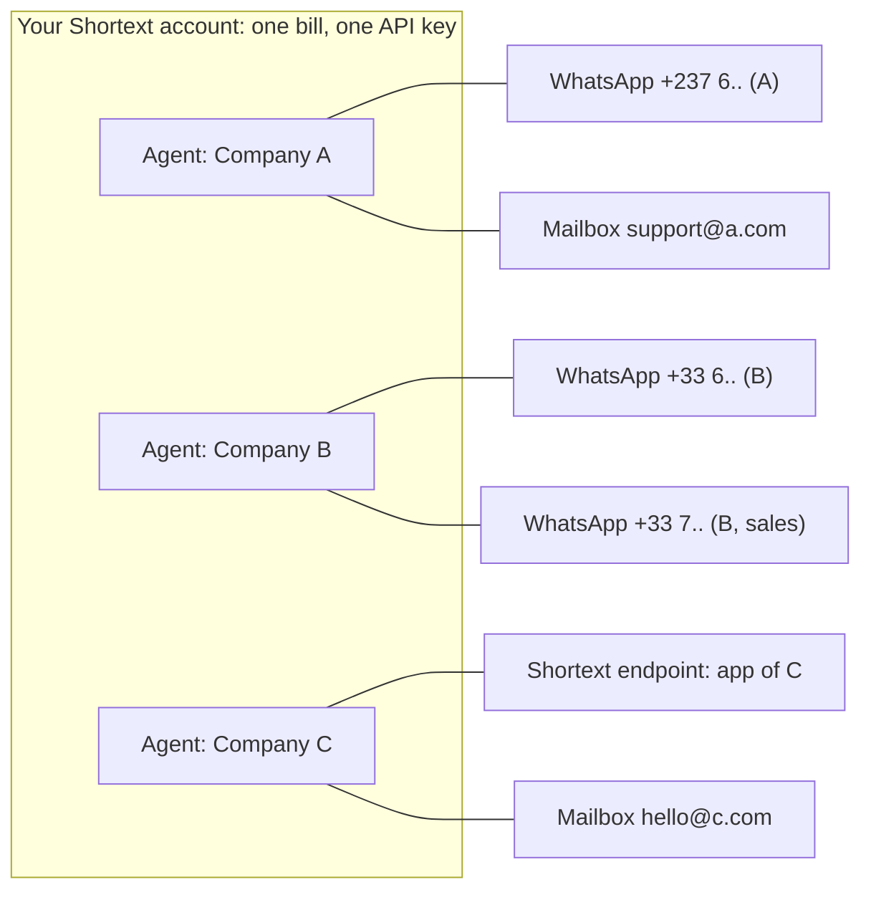

You integrate Shortext for **several companies**: your clients, your franchises, the brands of a group. You do not need one Shortext account per company. Create **one agent per company** in your own Shortext account, and attach to each agent the channels of that company.

## The model

- **One company = one agent.** The agent carries the identity of the company: its name, its instructions (tone, rules, what it may say), its knowledge base, its tools, its tickets.
- **One agent, several channels.** An agent can answer on as many channels as the company has: several WhatsApp numbers, mailboxes, Shortext endpoints for its apps. Every conversation of these channels is answered by the company's agent.
- **One account, one bill.** All usage is debited from the single wallet of your account. You manage one subscription, one balance and one set of invoices, whatever the number of companies.

## What each agent keeps separate

Everything that defines how a company is served lives on its agent:

| Per agent | Where |
| --- | --- |
| Instructions and AI settings | [Create an agent](/agents/creating-an-agent) |
| Knowledge base and contact knowledge | [Agent knowledge](/api-reference/guides/agent-knowledge) |
| Tools (calls to the company's own APIs) | [Tools](/agents/tools-configuration) |
| Channels (WhatsApp numbers, mailboxes, Shortext endpoints) | [Channels](/channels/overview) |
| Ticket statuses and SLA policies | [Manage tickets](/api-reference/guides/manage-tickets) |
| Apps opened by dynamic links | [Dynamic links](/api-reference/guides/dynamic-links) |

And the API lets you work company by company: filter conversations with `agent_id`, filter tickets with `agent_id`, and restrict a webhook endpoint to one agent with `filters.app`.

## Set it up

<Steps>
  <Step title="Create one agent per company">
    In **Communication > AI Agents**, or with `POST /agents`. Name it after the company, so your team recognizes it in the Inbox. Write instructions that speak for that company.
  </Step>
  <Step title="Connect the company's channels to its agent">
    Connect each WhatsApp number, mailbox or Shortext endpoint and choose the company's agent. You can also let the company connect its own WhatsApp number or mailbox from your product with a [hosted session](/api-reference/guides/connect-whatsapp), passing `context.agent_id`: the new channel is attached to the right agent directly.

    <Warning>Always pass `context.agent_id` when you serve several companies: without it, the new channel is attached to the first agent of your account.</Warning>
  </Step>
  <Step title="Give each agent its knowledge and tools">
    Upload the company's documents and configure the tools that call its systems.
  </Step>
  <Step title="Route events per company">
    Create one webhook endpoint per company with `"filters": { "app": "AGI-XXXXX" }`, or a single endpoint and route on the agent of each event (`channel_id`, conversation).
  </Step>
</Steps>

## Things to plan for

- **Agent limit.** Your plan sets how many agents your account can have, so how many companies you can serve. See [Agent limit of your plan](/agents/creating-an-agent#agent-limit-of-your-plan).
- **Team access.** Members of your account see the conversations of every agent, within what their role allows. Shortext does not restrict a member to one agent: give dashboard access to your own team, and if a company needs to see its own conversations, build that view in your product with the API, filtered by `agent_id`.
- **Re-billing your clients.** The wallet is shared: movements are not split per agent. To re-bill each company, count its activity through the API, for example its conversations with `GET /conversations?agent_id=...`.
- **One API key for all.** API keys belong to your account and reach every agent. Keep them on your servers; never hand one to a client company.

<Tip>A company that needs its own billing, its own team with separated access, or its own API keys should have its own Shortext account instead.</Tip>
